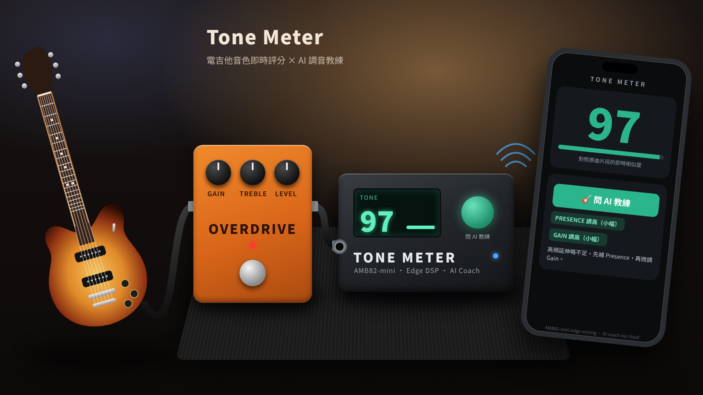
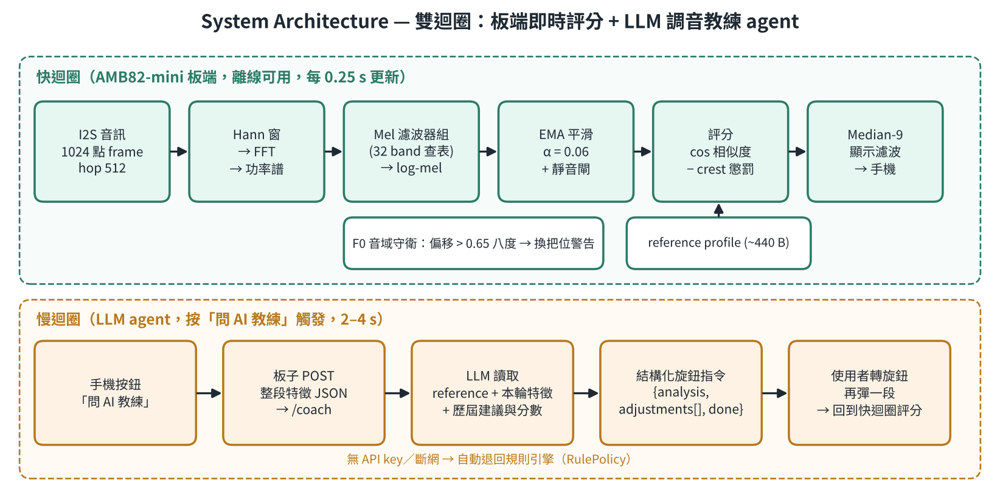

# 計畫構想書：電吉他音色即時評分與 AI 調音教練（Tone Meter）

| 項目 | 內容 |
|---|---|
| 組員 | 電機4A 01253036 葉安哲、電機4B 01253136 李吉麒 |
| 使用 AMB82-mini 晶片 | **是**（主控板，負責即時評分與網頁伺服） |
| 願意參與瑞昱科技計畫評審 | **是** |

---

## 1. 動機與問題

想彈出原曲的電吉他音色，通常要反覆轉效果器和音箱的旋鈕（Gain、Treble、Mid、Presence），而且只能靠耳朵判斷，初學者很難知道「差在哪裡、該往哪個方向轉」。

本計畫要解決兩個問題：

1. **量化**：把「像不像原曲」變成一個即時分數，轉旋鈕時立刻看到方向對不對。
2. **指導**：分數卡住時，由 AI 直接說明該轉哪顆旋鈕、往哪個方向、轉多少。

## 2. 目標

- 板端即時評分：轉旋鈕後 < 1 s 反映在分數上，且完全離線可用
- 評分只反映音色，不受彈錯音、節奏、樂句內容影響
- AI 教練在約 5 輪內把分數從 70 分左右帶到 95 分以上
- 使用者只需要一支手機，不必安裝 App

## 3. 系統架構

採用**雙迴圈**設計，把「需要即時、確定性」的工作和「需要推理」的工作分開：

| | 快迴圈（AMB82-mini 板端） | 慢迴圈（LLM agent） |
|---|---|---|
| 工作 | FFT → log-mel → 評分 → 顯示 | 解讀特徵差異 → 產生旋鈕指令 |
| 更新率 | 每 0.25 s | 使用者按鈕觸發，2–4 s |
| 網路 | 不需要 | 需要（斷網時改用規則引擎） |
| 資料量 | 原始音訊只在板上處理 | 每次只上傳約 440 B 特徵 JSON |

板子與 AI 之間只傳**語意化的特徵**（頻帶能量占比、亮度、crest factor、log-mel 形狀），不傳音訊；AI 只輸出**有限詞彙的旋鈕指令**（`gain/treble/mid/presence` × `+/-` × `小/中/大`）。這樣做隱私負擔小、頻寬低，LLM 的輸出也有明確格式，可以直接驗證。

## 4. 功能規劃（功能加減）

| 功能 | 決定 | 理由 |
|---|---|---|
| 即時音色評分（log-mel 形狀 + crest） | **保留（核心）** | 計畫主軸；板端 CPU 可負擔 |
| 手機網頁儀表板 | **保留** | 板子沒有螢幕，使用時又放在地板上，手機是最合理的顯示位置 |
| 多輪 LLM 調音教練 | **保留** | 讓 AI 成為閉環控制器，而不只是一次性問答 |
| 規則引擎 fallback | **保留** | Demo 現場斷網時仍可運作 |
| F0 音域守衛 | **保留** | 防止彈錯把位被誤判成音色差 |
| 錄音上傳到雲端評分 | **刪減（改為備用）** | SDK 原生錄音是 MP4/AAC，上傳量大；改成板端算特徵 |
| 自適應 EMA 平滑 | **刪減** | 實驗顯示無法區分「換音符」與「轉旋鈕」；固定 α = 0.06 加 median 已足夠 |
| 時變效果偵測（chorus／compressor／delay） | **延伸** | 合成音驗證有效，但真實刷弦素材下 chorus 抓不到，需改用長窗調變頻譜 |
| NPU INT8 音色分類 CNN | **延伸** | NPU 是 CNN 推論引擎、不適合做 FFT，先保留給未來的分類模型 |
| 多樂器音源分離 | **延伸** | 原曲有其他樂器時才需要，在 server 端前置處理 |
| OLED 顯示 | **選配** | 斷網時的備援顯示 |

## 5. 創新點

1. **評分與演奏內容解耦**：不做時間對齊，只比較時間平均後的頻譜**形狀**，所以使用者彈不同樂句、彈錯音也能公平評分（換樂句仍有 98 分）。
2. **補上頻譜形狀的盲區**：真實音訊測試發現只看頻譜形狀分不出破音量，因此加入 crest factor 懲罰項，並設 0.3 的 deadband，容忍正常的演奏力度差。
3. **LLM 作為閉環控制器**：agent 保留每輪「建議 → 實際變化」的歷史；建議無效或推過頭時會反向修正，不會一直重複同一條建議。
4. **依硬體規格查證決定架構**：AMB82-mini 沒有 line-in，所以加 PCM1808；SDK 錄音是 AAC，所以改傳特徵；NPU 不適合 DSP，所以 FFT 走 CPU（CMSIS-DSP）。

## 6. 關鍵技術

**訊號處理鏈**：16 kHz → 1024 點 Hann 窗 FFT（hop 512）→ 功率譜 → 32-band mel 濾波器組（Python 預先算好，輸出成 C header 常數表）→ log → EMA。

**評分公式**

$$
\text{score} = 100\cdot\mathrm{clip}\!\left(\frac{\cos(\tilde r,\tilde u)-0.7}{0.3}\right) - 16\cdot\max\!\left(0,\left|\log_2\frac{C_u}{C_r}\right|-0.3\right)
$$

- **頻譜形狀項**：log-mel 減去平均值等於除掉整體增益，所以 cosine 相似度只反映 EQ／破音造成的頻譜形狀差異，與音量無關。
- **動態項**：$C=\text{peak}/\text{RMS}$。破音與壓縮會削掉波峰，使 $C$ 下降，所以 $C$ 是破音量的時域指標。
- **兩種統計量**：即時顯示用瞬時 EMA（反應快）；reference 建立和 agent 每輪量測則用整段的 EMA 快照平均（`run_segment()`），每個時間點權重相同，避免長段落偏重尾端。

**板端運算量**：1024 點 FFT × 31.25 次/s，加上 32×513 次查表乘加；在 500 MHz Cortex-M33 上估計 < 5% CPU。

## 7. 目前驗證結果

| 項目 | 結果 |
|---|---|
| 板端 vs 雲端評分一致性 | r = 0.999 |
| 追蹤速度 | 轉旋鈕後 0.4–0.75 s 到位 |
| 真實歌曲鑑別度 | 同音色彈別段 91、加破音 65.7、lowpass 1.2k 50.5 |
| 音域守衛 | 高八度正確警告，音色差不誤報 |
| Agent 閉環 | 5 輪收斂 73.6 → 95.5 |
| 自動化測試 | 36 項全過 |

## 8. 實作步驟

1. PCM1808 接 AMB82-mini I2S，校正 line level
2. 燒錄 `amb82_tone_meter.ino`：掛 audio callback、對齊 CMSIS-DSP rfft 輸出格式、從 SD 卡載入 reference profile
3. 用 `micros()` 量 `processFrame()` 耗時，確認遠小於 32 ms 的 frame 週期
4. 板子提供 `ui.html` 網頁，手機熱點拓撲實測
5. 串接筆電 `/coach`，用真吉他完成多輪調音 demo
6. 用真吉他重新校正音域守衛門檻
