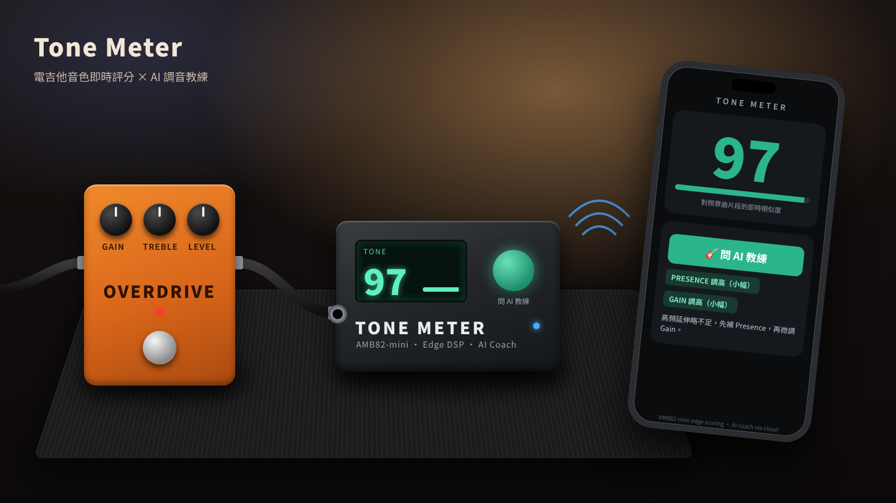
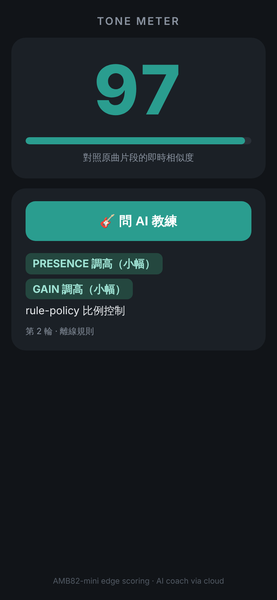
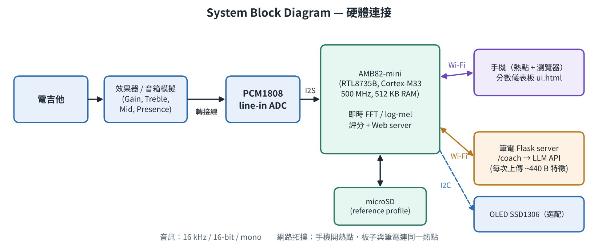
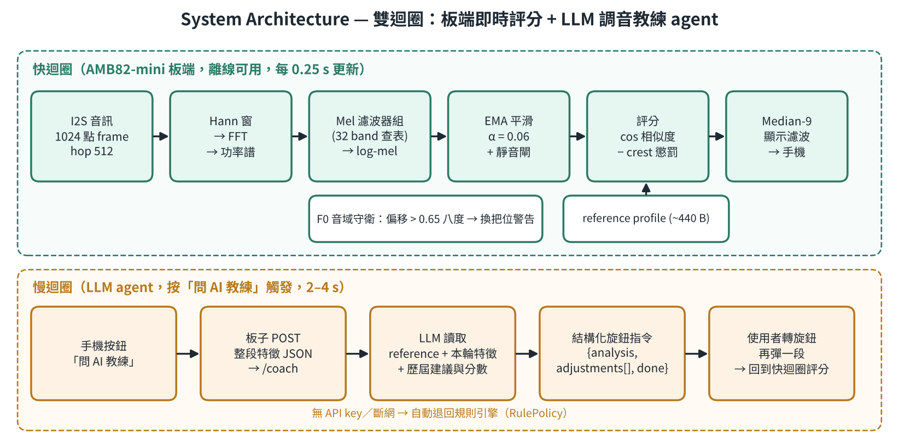
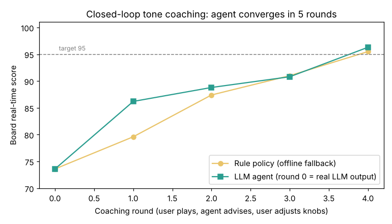

# Tone Meter — 電吉他音色即時評分與 AI 調音教練

> **本計畫使用 AMB82-mini 晶片**（Realtek RTL8735B）



**組員**：電機4A 01253036 葉安哲、電機4B 01253136 李吉麒

以原曲片段為基準，**即時評分**使用者的電吉他音色（0–100 分），再由 **LLM agent** 給出效果器／音箱旋鈕的具體調整指令。評分在 AMB82-mini 板端完成，不需要連網；AI 建議才走雲端，斷網時自動改用內建規則引擎。

---

## 功能

| 功能 | 說明 | 運算位置 |
|---|---|---|
| 即時音色評分 | 與原曲 reference profile 比較頻譜形狀與動態，每 0.25 s 更新 | 板端 |
| 顯示濾波與靜音閘 | median-9 濾掉撥弦瞬間的尖波；停下來調旋鈕時分數凍結 | 板端 |
| 音域守衛 | F0 與原曲偏移 > 0.65 八度 → 提示「請在原曲把位附近彈」，避免誤判成音色問題 | 板端 |
| AI 調音教練 | 多輪閉環 agent：讀取本輪特徵與歷次建議，輸出結構化旋鈕指令 | 雲端（筆電） |
| 離線 fallback | 無 API key 或斷網時改用規則引擎（比例控制） | 雲端（筆電） |
| 手機儀表板 | 手機瀏覽器開板子 IP 即可看分數、警告、AI 建議，不用另外裝 App | 板端提供網頁 |



---

## System HW & SW specifications

### System Block Diagram


### Hardware

1. **EVB：AMB82-mini**（RTL8735B, Arm v8-M 500 MHz, 512 KB RAM）— 主控與即時評分
2. **PCM1808 line-in ADC 模組**（必要）— AMB82-mini 沒有 3.5 mm line-in，官方音訊輸入只有板載類比麥克風與 I2S。效果器的 line 輸出要先經 PCM1808 轉成 I2S 再進板
3. 6.3 mm → 3.5 mm 轉接線
4. microSD 卡（FAT32）— 存放 reference profile
5. 手機 — 儀表板，同時開熱點當路由器
6. 筆電 — 執行 AI 教練 server（Python / Flask）
7. OLED SSD1306（選配）— 斷網時備援顯示分數

| 項目 | 規格 |
|---|---|
| 音訊 | 16 kHz / 16-bit / mono |
| 頻譜分析 | 1024 點 FFT、hop 512（31.25 frame/s）、32-band log-mel |
| 評分反應時間 | 轉旋鈕後 0.4–0.75 s 到位（模擬實測） |
| AI 建議延遲 | 2–4 s（主要是 LLM API 回應時間） |
| 上傳資料量 | 每次問 AI 約 440 B 特徵 JSON，不上傳音訊 |
| 板端 CPU 佔用 | 估計 < 5%（實機待量測） |

### LLM + Agent

- **ToneCoachAgent**（`agent.py`）：每輪輸入 reference 特徵、本輪特徵與歷次「建議 → 分數變化」，輸出 `{analysis, adjustments[], done}` 結構化指令。每輪最多調 2 顆旋鈕（gain / treble / mid / presence），上一輪建議沒有效果時會換策略。
- LLM：Claude API（設定 `ANTHROPIC_API_KEY`）。沒有 key 時退回 `RulePolicy` 規則引擎。

---

## Architecture



```text
吉他 → 效果器 → PCM1808 (I2S) → AMB82-mini
                                    │
  ┌──── 快迴圈（板端，離線）─────────┤
  │ frame 1024 / hop 512 → Hann → FFT → 功率譜
  │ → mel 查表 (32 band) → log-mel → EMA (α=0.06)
  │ → 與 reference 比對：shape − crest 懲罰 → 0–100 分
  │ → median-9 → 手機每 0.25 s 更新（並行：F0 音域守衛）
  └─────────────────────────────────┘
  ┌──── 慢迴圈（LLM agent）─────────┐
  │ 手機按「問 AI 教練」→ 板子 POST ~440 B 特徵到 /coach
  │ → LLM 讀 reference + 本輪 + 歷史 → 旋鈕指令 JSON
  │ → 使用者照做再彈 → 下一輪依結果修正策略
  └─────────────────────────────────┘
```

**評分公式**

$$
\text{score} = \underbrace{100\cdot\mathrm{clip}\!\left(\frac{\cos(\tilde r,\tilde u)-0.7}{0.3}\right)}_{\text{頻譜形狀}} \;-\; \underbrace{16\cdot\max\!\left(0,\;\left|\log_2\frac{C_u}{C_r}\right|-0.3\right)}_{\text{動態／破音量懲罰}}
$$

- $\tilde r,\tilde u$：reference 與使用者的 32-band log-mel 向量，各自減去平均值。在 log 域減平均等於除掉整體增益，因此只比「頻譜形狀」（音色），不受音量影響。
- $C = \text{peak}/\text{RMS}$（crest factor）：破音與壓縮會削峰、壓低 crest，所以 crest 反映破音量。實測只看頻譜形狀時，clean tone 加重破音仍有 95 分；加入 crest 項後降到 65.7，才分得出破音量。
- EMA 時間常數約 $1/(0.06\times31.25)\approx0.53$ s，兼顧轉旋鈕時的反應速度與分數穩定度。

---

## 驗證成果（模擬＋真實音訊）

| 項目 | 結果 |
|---|---|
| 板端 vs 雲端（CQT+MFCC）評分一致性 | r = 0.999 |
| 真實歌曲劣化階梯（September 吉他 cover） | 原段 100／同音色彈別段 91／lowpass 2.5k 78／加破音 65.7／lowpass 1.2k 50.5 |
| 換樂句、彈錯音 | 分數不受影響（合成音 98+） |
| 音域守衛 | 高八度 0.73 八度 ⚠ 正確警告；音色差（0.26）不誤報 |
| Agent 閉環 | 5 輪收斂 73.6 → 95.5；建議推過頭時會反向修正 |
| 自動化測試 | `tests/test_all.py` 36 項全過 |



---

## 目前進度與限制

- ✅ 演算法、手機儀表板、AI 教練 server 已在 PC 上模擬驗證
- 🔜 實機整合：PCM1808 接 I2S、`amb82_tone_meter.ino` 燒錄（audio callback、CMSIS-DSP rfft 輸出格式、SD 載入 profile）、用 `micros()` 量 `processFrame()` 耗時
- ⚠ 音域守衛門檻用合成音校定，真實和弦下餘裕小，需要用真吉他重新校正
- ⚠ chorus／compressor／delay 等時變效果的特徵已做實驗，但還沒整合進評分

---

## 程式碼結構

程式碼放在組員的專案 repo，本 repo 只放計畫報告。主要檔案如下：

```text
guitar-tone-demo/
├── board_rt.py          板端演算法參考實作（C++ 移植藍本）＋ 輸出 mel_table.h
├── agent.py             ToneCoachAgent 多輪調音教練（LLM / 規則雙 policy）
├── server.py            Flask：/coach /advise /analyze + 手機頁 /ui
├── ui.html              手機儀表板
├── amb82_recorder/
│   ├── amb82_tone_meter.ino   板端即時版（主線）
│   └── amb82_recorder.ino     錄音上傳版（備用）
├── analyze.py           雲端完整評分（CQT+MFCC，驗證基準）
├── exp_*.py             各項設計參數的實驗
├── song_test.py         真實歌曲測試
└── tests/test_all.py    自動化測試
```

---

## AI 工具使用說明

- 成品示意圖由 AI（Claude）生成，為概念示意，非實機照片。
- README.md 與 PROPOSAL.md 由 AI（Claude）依專案程式與實驗結果協助整理。

---

## [PROPOSAL.md](PROPOSAL.md)
